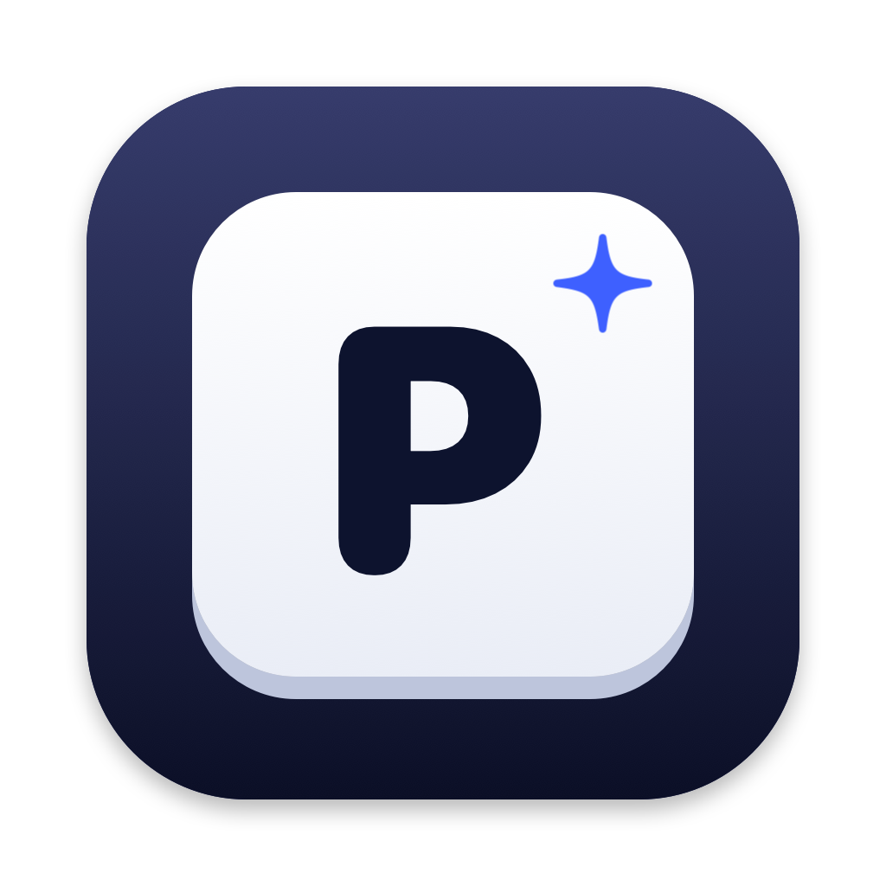
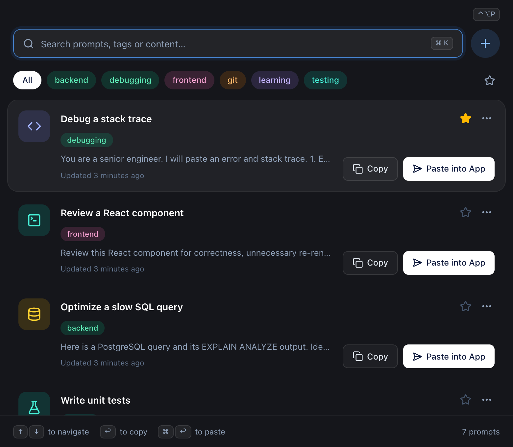
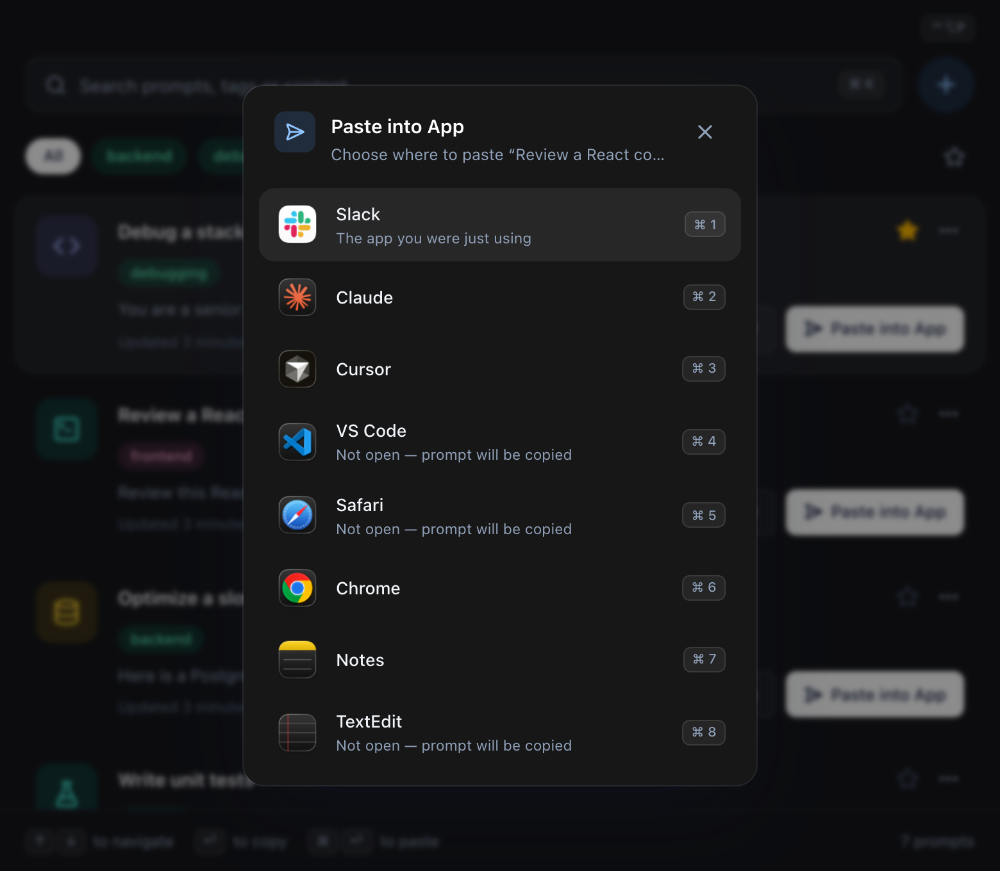
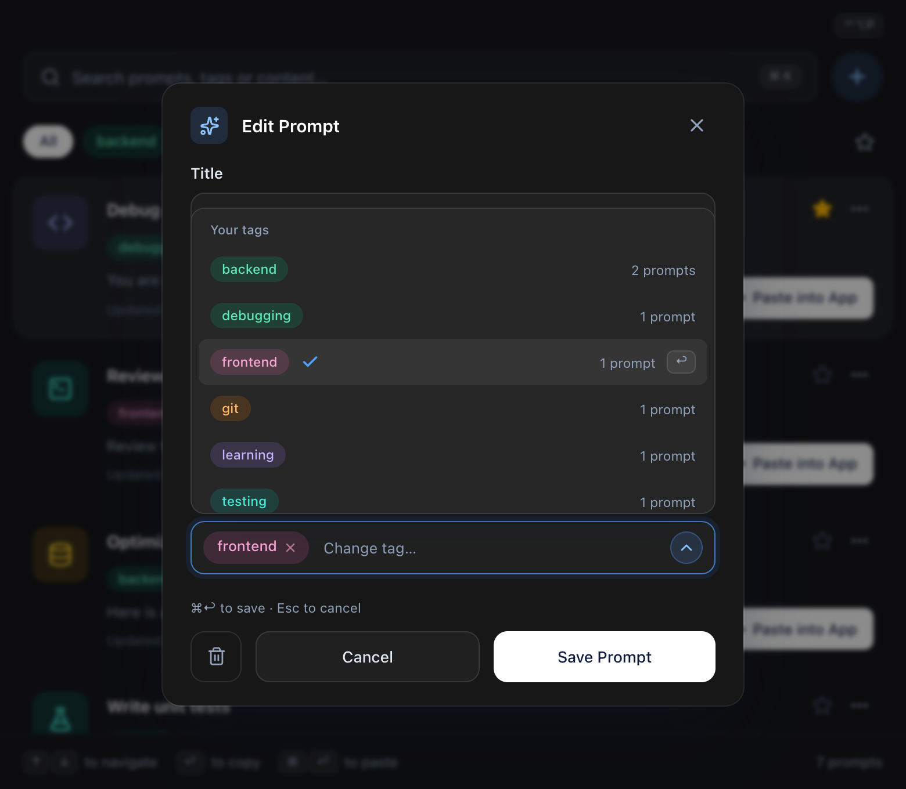

<p align="center">
  
</p>

<h1 align="center">Promptr</h1>

<p align="center">
  <b>Your AI prompts, one shortcut away.</b><br>
  A tiny Mac menu bar app to save, search and paste your favorite prompts into Claude, ChatGPT, Cursor and more.
</p>

<p align="center">
  <a href="https://github.com/urvichawla/Promptr/releases/latest/download/Promptr.dmg"><b>⬇&nbsp; Download for Mac</b></a>
  &nbsp;·&nbsp; macOS 13 or later &nbsp;·&nbsp; Apple Silicon and Intel &nbsp;·&nbsp; Free
</p>

<p align="center">
  
</p>

## Why Promptr

You keep reusing the same prompts: a code review checklist, a debugging template, a commit-message prompt. Promptr keeps them one keystroke away from whatever you're doing.

- **Open from anywhere** with **⌃⌥P** (Control + Option + P), or from the **P** icon in your menu bar
- **Find prompts instantly** with search that forgives typos (`reakt` still finds React)
- **Paste straight into the app you were using**: Claude, ChatGPT, Cursor, VS Code, Notes, Slack, your browser…
- **Organize with tags** and **star** the prompts you use most
- **Private by design**: everything stays on your Mac. No account, no cloud, works offline.

<table>
  <tr>
    <td width="50%"></td>
    <td width="50%"></td>
  </tr>
  <tr>
    <td align="center"><b>Paste into any app</b>, with one click or <kbd>⌘</kbd> + number</td>
    <td align="center"><b>Add and edit prompts</b>, and pick or create a tag</td>
  </tr>
</table>

## Install

1. **[Download Promptr.dmg](https://github.com/urvichawla/Promptr/releases/latest/download/Promptr.dmg)** and open it. (All versions are on the [Releases](https://github.com/urvichawla/Promptr/releases) page.)
2. Drag **Promptr** onto the **Applications** folder.
3. Open **Promptr** from Applications or Spotlight.
4. If macOS says *"Apple could not verify Promptr"*: open **System Settings → Privacy & Security**, scroll down and click **Open Anyway** next to Promptr, then confirm. You only need to do this once.

A **P** icon appears in your menu bar. Promptr has no Dock icon; it lives in the menu bar.

> **Why the extra step?** Promptr isn't signed with a paid Apple Developer certificate yet, so macOS asks you to confirm the first time. The app is open source, and you can read every line in this repository.

### Allow pasting (one time)

Copying works straight away. To let Promptr **paste into other apps** for you, macOS needs your permission, because pasting means sending a ⌘V keystroke:

1. Use **Paste into App** once. Promptr shows a yellow banner. Click **Open Settings**.
2. Switch **Promptr** on under **Privacy & Security → Accessibility**.
3. Quit Promptr from its menu bar icon and open it again.

## How to use

1. Press **⌃⌥P** from any app. Promptr appears with the search box ready.
2. Type a few letters to find a prompt.
3. Press **↩** to copy it, or **⌘↩** to paste it straight into the app you were just in.

| Shortcut | What it does |
|---|---|
| <kbd>⌃</kbd> <kbd>⌥</kbd> <kbd>P</kbd> | Show or hide Promptr from any app |
| <kbd>↑</kbd> <kbd>↓</kbd> | Move through prompts |
| <kbd>↩</kbd> | Copy the selected prompt |
| <kbd>⌘</kbd> <kbd>↩</kbd> | Paste the selected prompt into your last chosen app |
| <kbd>⌘</kbd> <kbd>K</kbd> | Jump to search |
| <kbd>⌘</kbd> <kbd>N</kbd> | New prompt |
| <kbd>⌘</kbd> <kbd>E</kbd> | Edit the selected prompt (or double-click it) |
| <kbd>Esc</kbd> | Clear the search, then the filters, then hide Promptr |

**Tips**

- **Paste into App** on a prompt lets you pick where it goes. The app you were just using is listed first; press <kbd>⌘</kbd> + a number to choose quickly. Promptr remembers your choice for <kbd>⌘</kbd> <kbd>↩</kbd>.
- **Tags:** each prompt has one tag. Click a tag at the top to filter, then click **All** to go back.
- **Favorites:** click ☆ on a prompt to star it. Starred prompts move to the top the next time you open Promptr, and the ☆ at the end of the tag bar shows only starred prompts.
- **More actions:** the **…** button on a prompt has Edit, Copy, Star and Delete.
- **Menu bar icon:** click it for **Open Promptr**, **Add Prompt** and **Quit**.
- Promptr hides itself when you click into another app, so it never gets in the way.

## Your data

Your prompts are stored only on your Mac, in:

```
~/Library/Application Support/Promptr/prompts.db
```

Promptr has no account and no server, and it doesn't send anything over the internet. To back up your prompts, copy that file while Promptr is quit.

## Troubleshooting

**"Apple could not verify Promptr" / the app won't open.** Use **Open Anyway** in **System Settings → Privacy & Security** (see [Install](#install)).

**Paste into App only switches apps, or the yellow banner keeps coming back.** macOS may still have permission recorded for an older copy of Promptr, which can happen after updating. In **Privacy & Security → Accessibility**, select Promptr and click **–**, add it again with **+**, switch it on, then quit and reopen Promptr.

**The menu bar icon is missing.** On MacBooks with a notch, a crowded menu bar can hide icons behind it, and macOS can turn app icons off in **System Settings → Menu Bar**. You can always open Promptr with **⌃⌥P** or from Spotlight.

**The header says "Shortcut unavailable".** Another app is already using ⌃⌥P. Hover the label for details, and use the menu bar icon instead.

## Uninstall

Quit Promptr from its menu bar icon, drag **Promptr** from Applications to the Bin, then delete your prompts if you no longer want them:

```bash
rm -rf ~/Library/Application\ Support/Promptr ~/Library/Logs/Promptr
```

---

# For developers

Promptr is built with [Wails v2](https://wails.io) (Go backend + native macOS window), a [Next.js](https://nextjs.org) frontend exported as static files, Tailwind CSS, [Fuse.js](https://www.fusejs.io) for fuzzy search, and SQLite for storage.

## Requirements

| | Version used | Notes |
|---|---|---|
| macOS | 13 Ventura+ (tested on 26) | Apple Silicon or Intel; 13 is Go 1.27's minimum |
| Xcode Command Line Tools | any recent | `xcode-select --install` |
| Go | 1.26+ (tested 1.27) | `brew install go` |
| Node.js | 20.9+ | required by Next.js 16 |
| Wails CLI | v2.17 | `go install github.com/wailsapp/wails/v2/cmd/wails@latest` |

Make sure Go's bin folder is on your `PATH` (add to `~/.zshrc`):

```bash
export PATH="$PATH:$HOME/go/bin"
```

Check everything with `wails doctor`.

## Run in development

```bash
wails dev
```

This starts the Next.js dev server on port 3210 and opens the app. Go changes rebuild automatically; after frontend changes press **⌘R** in the window. The same app is also reachable at http://localhost:34115 in a browser (handy for inspecting the UI; native features like paste only work in the real window).

## Build

Quick local build for your own Mac:

```bash
wails build
open build/bin/Promptr.app
```

For a release build (universal app + DMG), see [Packaging and distribution](#packaging-and-distribution).

## Project structure

```
main.go                     Wails options: window, menus, embedded frontend
app.go                      App lifecycle and wiring (database, clipboard, paste service, macOS callbacks)
bindings_*.go               Thin methods the frontend calls: prompts, paste, window
internal/
  store/                    SQLite: migrations, validation, prompts, settings (+ tests)
  paste/                    Paste targets and the paste workflow, behind a System interface (+ tests with a fake Mac)
  clipboard/                Verified copy: write, read back, compare (+ tests)
  macos/                    Objective-C via cgo: menu bar, hotkey, window, app switching, Accessibility, ⌘V
  applog/                   Small file logger (~/Library/Logs/Promptr)
frontend/
  app/                      Next.js entry (layout, page, global styles)
  components/
    launcher/               Main window: composition, header, list, footer, banner, toast
    prompt/                 Prompt row and its … menu
    editor/                 Add/Edit form and the tag picker
    filters/                Search bar and tag filter bar
    paste/                  Paste-into-app chooser
    ui/                     Shared pieces: buttons, chips, keycaps, dialogs, empty states
  hooks/                    State and behavior: data, filters, actions, notices, shortcuts, window events
  lib/
    api/                    The only code that calls Go (wraps the generated bindings)
    prompts/                Pure logic: types, validation, search, colors and icons
  wailsjs/                  Generated Go bindings — do not edit; `wails dev/build` regenerate them
build/                      App icon and Info.plist templates used by `wails build`
design/                     App icon options and README screenshots
scripts/package.sh          Release build: checks, universal app, signing, DMG, checksum, optional notarization
```

### How it fits together

- The Next.js UI is exported to plain static files (`output: "export"`) and embedded into the Go binary with `//go:embed`; there is no Next.js server at runtime.
- The UI calls Go through Wails bindings (`frontend/wailsjs/go/main/App`), which return Promises. Only `frontend/lib/api` imports them.
- Wails v2 has no tray or global-shortcut API, so `internal/macos` uses `NSStatusItem` and Carbon's `RegisterEventHotKey` (no Accessibility permission needed for the shortcut).
- Paste into App activates the target, waits until macOS confirms it is frontmost, hides Promptr and posts ⌘V with `CGEventPost`. Anything that fails along the way leaves the prompt on the clipboard and says why. Each attempt is logged to `~/Library/Logs/Promptr/paste.log`.
- The database schema is versioned with SQLite's `PRAGMA user_version`; each migration in `internal/store/migrations.go` runs once, in a transaction.

## Tests

```bash
go test ./...
cd frontend && npx tsc --noEmit
```

The Go tests cover storage, validation, Unicode normalisation, migrations, the paste workflow (against a fake Mac) and verified clipboard copies. UI and native behaviour are covered by the manual checklist at the end.

During development, every rebuild is signed ad hoc, so macOS treats it as a new app and the Accessibility permission stops applying. Reset it after rebuilding:

```bash
tccutil reset Accessibility app.promptr.mac
```

## Packaging and distribution

`scripts/package.sh` runs the checks, builds a **universal** app (Apple Silicon + Intel), signs it, wraps it in a DMG with an Applications shortcut, and writes a SHA-256 checksum. It never uploads anything unless you set `NOTARY_PROFILE` (which sends the DMG to Apple for notarization).

```bash
./scripts/package.sh
```

Output:

```
build/bin/Promptr.app            universal app (x86_64 + arm64)
dist/Promptr.dmg                 installer image (same name every release, so the download link never changes)
dist/Promptr.dmg.sha256          checksum, for your own verification
```

The version comes from `info.productVersion` in `wails.json`. Bump it there before each release.

The script also sets `-mmacosx-version-min=13.0` so the binary and `Info.plist` agree on the real minimum (Go 1.27 targets macOS 13), and builds with `-trimpath -ldflags "-s -w"` so no local paths or debug symbols end up in the app.

### Code signing and notarization

macOS decides whether to trust a downloaded app based on its signature:

| Signature | What it costs | What users see after downloading |
|---|---|---|
| **Ad hoc** (default, `SIGN_IDENTITY` unset) | Free | "Apple could not verify…" — they must use **Open Anyway** in Privacy & Security once. |
| **Developer ID**, not notarized | Apple Developer Program, $99/year | Blocked the same way as ad hoc — Gatekeeper has required notarization since macOS 10.15. |
| **Developer ID + notarized + stapled** | Same membership | Opens normally, like any app from the web. |

A Developer ID signature also keeps the app's identity stable across versions, so users don't have to re-grant Accessibility after updating.

To sign and notarize once you have a Developer ID Application certificate in your keychain:

```bash
# one-time: store notarization credentials in the keychain (use an app-specific password from appleid.apple.com)
xcrun notarytool store-credentials promptr-notary --apple-id you@example.com --team-id TEAMID

# each release
SIGN_IDENTITY="Developer ID Application: Your Name (TEAMID)" NOTARY_PROFILE=promptr-notary ./scripts/package.sh
```

The script signs with the hardened runtime and a secure timestamp (both required for notarization), submits the DMG with `notarytool`, waits for Apple's verdict, and staples the ticket so it works offline. Promptr needs no extra entitlements: it isn't sandboxed, WebKit's JavaScript engine runs in Apple's own processes, and Accessibility is granted by the user rather than declared.

### Publishing a release

Replace `1.3.1` with the version in `wails.json`. Upload only `Promptr.dmg`, so visitors see a single installer and the README's download link keeps working:

```bash
git tag v1.3.1
git push origin v1.3.1
gh release create v1.3.1 dist/Promptr.dmg --title "Promptr 1.3.1" --notes "Download Promptr.dmg, open it and drag Promptr to Applications. See the README for details."
```

The README's download link always points to the latest release.

### Clean-Mac test checklist

Test on a Mac (or a fresh macOS user account) that has never had Promptr, Go, Node or Wails:

- [ ] Download the DMG from the release page in Safari (so it gets the quarantine flag real users get)
- [ ] `shasum -a 256 Promptr.dmg` matches the sha256 GitHub shows next to the file on the release page
- [ ] DMG opens and shows Promptr next to an Applications shortcut; drag to install
- [ ] First launch: unsigned → **Open Anyway** works; notarized → opens with only the standard "downloaded from the internet" prompt
- [ ] No Dock icon; menu bar icon appears; ⌃⌥P toggles the window
- [ ] Seven sample prompts appear; `~/Library/Application Support/Promptr/prompts.db` is created
- [ ] Add, edit, delete, search and tag filtering work; changes survive quit and relaunch
- [ ] Copy works; paste works after granting Accessibility
- [ ] Works on both an Apple Silicon and an Intel Mac (or Intel via `arch -x86_64`)
- [ ] macOS 12 or older refuses to open it with a "requires macOS 13" message instead of crashing

## Manual test checklist

**Launch and window**
- [ ] No Dock icon; **P** key icon in the menu bar
- [ ] ⌃⌥P shows Promptr over the current app and focuses search; ⌃⌥P again hides it
- [ ] Menu bar icon opens Open Promptr / Add Prompt / Quit
- [ ] Clicking another app hides Promptr; it stays open while a form or dialog is open
- [ ] Opens on the current Space and over fullscreen apps
- [ ] Light and dark mode both look right

**Prompts**
- [ ] Add, edit, delete; empty title/prompt and duplicate titles (any case, including accents) are rejected
- [ ] Each prompt has one tag: picking from the dropdown selects it and closes the menu; tags normalise (`React` → `react`, spaces → hyphens), 24 characters max
- [ ] Unsaved changes: Esc warns once, second Esc discards; saving an unchanged prompt just closes
- [ ] Starring a prompt fills the star in place; it moves to the top after reopening Promptr
- [ ] A 20,000-character prompt with a long URL displays without overflow and searches without lag
- [ ] Quit and relaunch: all changes are still there

**Search and tags**
- [ ] `deb`, `reakt`, `sqll`, `eror` find the expected prompts
- [ ] Tag filter + search combine; empty state offers **Search everything** / **Clear search**
- [ ] Esc and ⌫ clear search and filters in order

**Copy and paste**
- [ ] ↩ and ⌘C copy; `pbpaste | cat -vet` shows tabs, line breaks and emoji intact
- [ ] ⌘↩ pastes into Claude, Cursor and Notes (after granting Accessibility)
- [ ] Target not running → "isn't open" message, prompt on clipboard
- [ ] Multi-line prompt to Terminal is refused and copied instead
- [ ] Without Accessibility: banner with **Open Settings**

## License

© 2026 Urvi Chawla. All rights reserved.
